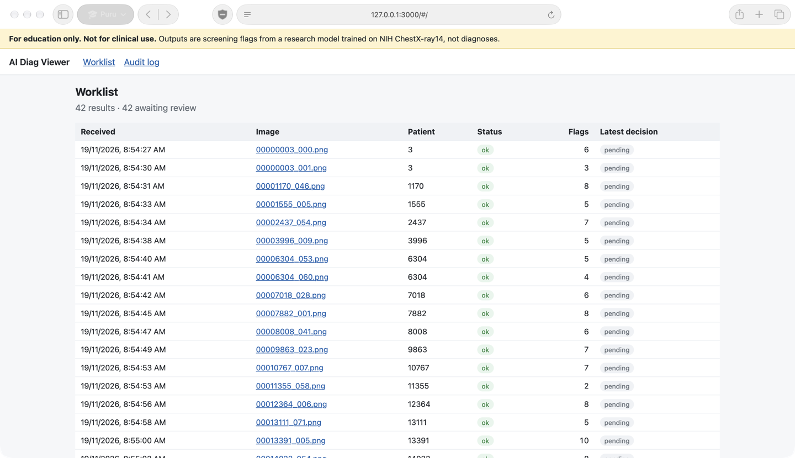
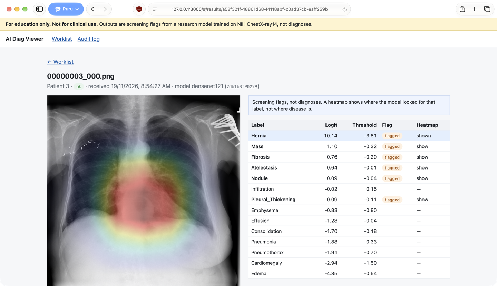
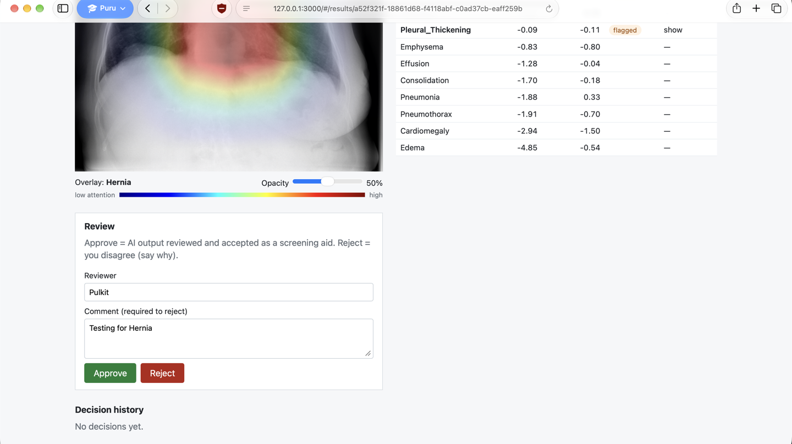
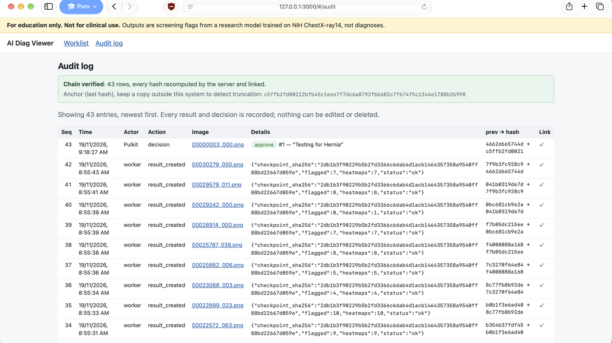
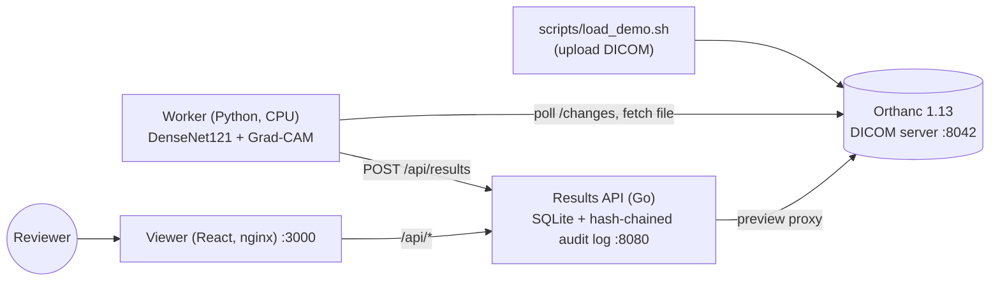
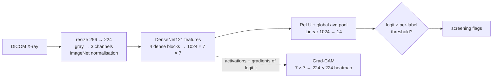

# AIML-02 · AI-Assisted Medical Imaging & Diagnosis System

> [!WARNING]
> **For education only. Not for clinical use.** The model produces *screening flags*, not diagnoses. It was trained on
> a public research dataset with noisy, text-mined labels and has known biases (see [Limitations](#limitations-and-bias)).

Upload a chest X-ray (DICOM) → a deep-learning worker scores 14 findings and draws a Grad-CAM heatmap for each one →
a reviewer sees the X-ray with the AI overlay and confidence, then **approves or rejects** it → every result and decision
lands in a **tamper-evident audit log**.

Built by Pulkit ([@arch-pulkit](https://github.com/arch-pulkit)) as internship project **AIML-02**.

| Deliverable | Where |
|---|---|
| Working demo (screen recording) | *link added after recording* |
| Setup instructions | [Quick start](#quick-start-demo-about-10-minutes) · [Full reproduction](#full-reproduction-data--training) |
| Architecture diagram | [Architecture](#architecture) · `docs/ARCHITECTURE.md` |
| API and data documentation | `docs/API.md` · `docs/DATA.md` |
| Test results and accuracy | [Testing](#testing) · [Results](#results) · `docs/MODEL_CARD.md` |
| Presentation and reflection | `docs/presentation.pdf` · `docs/REFLECTION.md` |
| Development log | `docs/DEVLOG.md` |

## Screenshots

| Worklist | Review: X-ray + Grad-CAM overlay |
|---|---|
|  |  |
| **Approve / reject with comment** | **Audit log with chain verification** |
|  |  |

## Features

**Data and versioning**
- NIH ChestX-ray14: 112,120 frontal chest X-rays, 14 text-mined labels. The official test list is the test set;
  train/val are split **by patient** (no patient in two splits), giving 69,625 / 16,899 / 25,596 images.
- The whole pipeline is a **DVC** DAG (8 stages: `make_splits`, `resize`, `train`, `predict`, `eval_metrics`,
  `thresholds`, `subgroups`, `localization`), with hyper-parameters in `params.yaml` and metrics in `reports/`.
- DICOM handling with pydicom: PNG → DICOM Secondary Capture converter (8-bit MONOCHROME2, deterministic UIDs),
  DICOM basics in `notebooks/01_dicom_basics.ipynb`.

**Classification (transfer learning)**
- DenseNet121 pretrained on ImageNet, new 14-logit head, `BCEWithLogitsLoss` with per-label `pos_weight` for class
  imbalance, AdamW (lr 1e-4, weight decay 1e-5), learning-rate reduction on plateau, 10 epochs on Apple M4 (MPS).
- Preprocessing: grayscale, offline LANCZOS resize to 256, 224 input, ImageNet normalisation. The only training
  augmentation is a small random affine transform (±7° rotation, ±5 % shift, 0.95–1.05 scale).
- **Per-label decision thresholds** chosen on validation (Youden's J). A label is *flagged* when `logit >= threshold`.

**Explainability and evaluation**
- Own Grad-CAM implementation on the last DenseNet feature block, one heatmap per label.
- **Grad-CAM localisation check** against 984 radiologist bounding boxes: the heatmap peak falls within 15 px of the box
  for 51 % of cases, against 36 % for a shuffled baseline.
- **Subgroup analysis** by sex, age and view position, which found a *view shortcut* (see [Results](#results)).

**Segmentation (results only, not served)**
- 3D U-Net in MONAI (4.8 M parameters) on the Medical Segmentation Decathlon spleen task (41 CTs, 33 train / 8 val),
  Dice loss, 600 epochs, trained and evaluated on a Kaggle T4 (`notebooks/04_spleen_unet.ipynb`).

**Serving pipeline**
- **Orthanc** DICOM server (login from `.env`, never overwrites stored instances).
- **Inference worker** (Python, CPU): follows Orthanc's change feed, runs the model and Grad-CAM, POSTs the result.
  *At-least-once* delivery: its cursor is saved only after the API accepted the result, and transient failures retry
  with exponential backoff, so no image is lost if the API restarts (tested with a 20 s outage: 0 lost).
- **Results API** (Go standard library + SQLite, 5.6 MB distroless image): results are write-once, duplicates are
  answered idempotently, and inputs are strictly validated. It proxies the X-ray preview from Orthanc.
- **Tamper-evident audit log:** every result and decision is a row in a hash chain. The database blocks
  `UPDATE`/`DELETE` with triggers, and `GET /api/audit/verify` recomputes every hash. A forged row is detected and
  shown in red in the viewer.

**Review viewer (React + Vite, served by nginx)**
- Worklist with status, flag count and review state. Detail page with the X-ray, Grad-CAM overlay (colour map,
  opacity slider, one label at a time), a labels table with logit vs threshold, and the decision history.
- Approve/reject with reviewer name and comment (a reject needs a comment). The form locks after saving, so a
  double-click can't record two decisions.
- Audit page, newest first: verify badge with the anchor hash, paged log, and a link check per row.
- Degrades gracefully: if Orthanc is down, only the X-ray image fails; if the API is down, a clear error appears.

**Packaging**
- One `compose.yaml`, 4 services, every base image **pinned by digest**, health checks, non-root containers,
  ports bound to `127.0.0.1` only. Demo assets are a GitHub release, verified against committed sha256 checksums.

## Architecture



The browser talks only to nginx on port 3000, which serves the built app and forwards `/api/` to the Go API. The
API is the single authority for results and decisions; the worker is its only writer of results. More detail, including
data-flow diagrams, the model architectures, one image end to end, the database schema and the deployment, is in
[`docs/ARCHITECTURE.md`](docs/ARCHITECTURE.md).

**Model: classifier and Grad-CAM**



## Quick start (demo, about 10 minutes)

**Prerequisites:** Docker Desktop (or Docker Engine with Compose v2), `git`, `curl` and `bash`. Ports 3000, 8080,
8042 and 4242 must be free on `127.0.0.1`. The first build downloads a few GB (the worker installs CPU PyTorch).
Tested on macOS (Apple M4). The pinned images are multi-arch, so Linux amd64 should work but is untested.

```bash
git clone https://github.com/arch-pulkit/AIML-02-ai-imaging-diagnosis.git
cd AIML-02-ai-imaging-diagnosis
cp .env.example .env
./scripts/fetch_assets.sh
docker compose up -d --build --wait
./scripts/load_demo.sh
```

What you should see:
1. `fetch_assets.sh` downloads the model checkpoint (27 MB) and 42 demo DICOMs (26 MB) from the
   [`assets-v1` release](https://github.com/arch-pulkit/AIML-02-ai-imaging-diagnosis/releases/tag/assets-v1) and
   prints `OK: 43 files verified against assets/SHA256SUMS`. It must run **before** the build, because the worker
   image contains the checkpoint. The 42 DICOMs are the seeded 40-image subset (`data/demo/demo_subset.csv`)
   plus `00000003_000` and `00000003_001`, the two images used for the first Orthanc test.
2. `docker compose up -d --build --wait` returns once all 4 services are up.
3. `load_demo.sh` prints `uploaded 42 files … Success 42, AlreadyStored 0`.
4. The worker analyses each image in about 1–1.5 s on CPU. Open **http://127.0.0.1:3000**: within about a minute the
   worklist shows 42 results.

Try it: open `00000003_000` (top label *Hernia*, heat behind the heart), move the opacity slider, approve it with your
name, then open **Audit log**. The badge is green and the newest row is your decision.

| URL | What |
|---|---|
| http://127.0.0.1:3000 | Review viewer |
| http://127.0.0.1:8080/api/results | Results API (JSON), see `docs/API.md` |
| http://127.0.0.1:8042 | Orthanc Explorer (login from `.env`, default `demo` / `demo`) |

Stop with `docker compose down`, which keeps all data. `docker compose down -v` **deletes** the volumes: Orthanc's
store, the results database with its audit log, and the worker's cursor.

## Results

**Classification, NIH ChestX-ray14 (DenseNet121)**

| | Mean AUROC |
|---|---|
| Validation (used for model and threshold selection) | 0.8285 |
| **Test (official NIH test list, 25,596 images)** | **0.8045** |

| Best on test | AUROC | Worst on test | AUROC |
|---|---|---|---|
| Hernia | 0.935 | Infiltration | 0.694 |
| Emphysema | 0.902 | Pneumonia | 0.699 |
| Cardiomegaly | 0.890 | Nodule | 0.736 |

- The drop from validation to test comes from selection optimism plus a sicker test set (Effusion 18.2 % vs 10.0 %;
  AP view 57 % vs 35 %).
- **Low precision for rare labels:** for example, Hernia PPV is 0.021 at the chosen threshold. The demo images get a
  median of 6 flags each, so flags are for screening, not diagnosis.
- **Subgroups:** no gap by sex, a slight decline with age, and a **view shortcut**: the Edema logit predicts the AP
  view (AUROC 0.862) better than it predicts Edema (0.842).
- **Grad-CAM localisation** (984 boxes): the peak lies within 15 px in 51 % of cases (shuffled baseline 36 %), with a
  median lift of 2.46 (baseline 1.59).
- Per-label numbers are in `reports/eval_metrics.json`, `reports/subgroup_metrics.json` and
  `reports/gradcam_localization.json`.

**Segmentation, MSD spleen (8 validation volumes)**

| Checkpoint | Dice |
|---|---|
| Best (epoch 425) | 0.942 |
| Plateau median | 0.895 (IQR 0.875–0.906) |
| Last epoch | 0.823 (2 volumes missed) |

With only 41 volumes, a validation set used for checkpoint selection, and no separate test set, these numbers are
optimistic.

**Serving and system checks**
- Inference: 0.35 s/image on the Mac CPU, about 1.1–1.3 s/image in Docker.
- Replaying all 42 worker payloads gave 42 created / 42 duplicates; all 256 heatmaps were byte-identical, and 20/20
  malformed payloads were rejected.
- A live run with a 20 s API outage lost 0 results. A forged audit row on a database copy was detected by
  `/api/audit/verify`.

## Testing

| Suite | Command | Result |
|---|---|---|
| Python (DICOM, model, evaluation, loss weights) | `python -m pytest -v` | 14 passed |
| Go results API | `cd services/api && go test -count=1 ./...` | 21 tests pass |
| Frontend lint and build | `cd frontend && npm ci && npm run lint && npm run build` | 0 lint errors |

The Python tests check DICOM windowing and display scaling, a PNG → DICOM → pixels round trip, deterministic UIDs,
the model's output shape and pretrained weights, AUROC evaluation against hand-computed values, and the `pos_weight`
computation (hand-computed and on the real label file).

The Go tests cover the database invariants (write-once results, append-only audit log, the triggers), result ingestion
and duplicates, decision validation, audit paging, hash verification with tamper detection, the Orthanc preview
proxy's error mapping, the container health check, and a replay of real worker payloads. Key tests were mutation-checked: the code was deliberately broken to confirm that the test
fails for the specific reason.

End-to-end checks done by hand (recorded in `docs/DEVLOG.md`): the overlay alignment matches an independent Python
composite; the viewer behaves correctly when Orthanc or the API is down; a double-click bug was found through the
audit log and fixed; the demo assets were verified from a fresh clone.

## Full reproduction (data → training)

The quick start uses the published checkpoint. To rebuild everything from the raw data:

1. **Data:** NIH ChestX-ray14 from Kaggle (`nih-chest-xrays/data`, about 45 GB), unpacked to `data/raw/nih/` with the
   layout `images_001/images/*.png` … `images_012/images/*.png` plus `Data_Entry_2017.csv`, `BBox_List_2017.csv`,
   `train_val_list.txt` and `test_list.txt` (112,128 files in total).
   ```bash
   kaggle datasets download nih-chest-xrays/data -p data/raw/nih
   unzip -q data/raw/nih/*.zip -d data/raw/nih && rm data/raw/nih/*.zip
   ```
   The download needs a Kaggle API token. On macOS, delete Finder's `.DS_Store` files before running DVC
   (`find data/raw/nih -name .DS_Store -delete`), because DVC hashes every file in the folder.
2. **Python environment (3.11):**
   ```bash
   uv venv --python 3.11 && source .venv/bin/activate
   uv pip install -r requirements-dev.txt && uv pip install -e .
   ```
   `requirements-dev.txt` is the exact environment used, verified in a fresh venv.
3. **Run the pipeline:** `dvc repro`. Training takes about 5 h on an Apple M4 (MPS). The metrics land in `reports/`.
4. **Segmentation:** `notebooks/04_spleen_unet.ipynb` (MSD Task09 Spleen; 600 epochs on a Kaggle T4).
5. **Demo DICOMs from your own copy:** `python -m src.data.demo_subset --upload` re-selects the seeded 40-image subset
   (`data/demo/demo_subset.csv`), converts it to DICOM and uploads it to Orthanc. This gives 40 of the 42 demo
   images; the other two (`00000003_000`, `00000003_001`, used in the *Try it* step) come from the release via
   `fetch_assets.sh` + `load_demo.sh`.

There is no DVC remote: the 45 GB dataset is public and is re-downloaded from its source instead.

## Repository map

| Path | Contents |
|---|---|
| `src/data/` | NIH loading, patient-level splits, resizing, DICOM I/O, demo subset |
| `src/models/`, `src/train/` | DenseNet121 classifier and training loop |
| `src/evaluation/`, `src/explain/` | Metrics, thresholds, subgroups, Grad-CAM and its localisation check |
| `src/serve/` | Inference, Orthanc client, worker, and a stub API used in testing |
| `services/api/` | Go results API (SQLite schema, audit chain, tests, Dockerfile) |
| `services/worker/` | Worker Dockerfile and pinned requirements |
| `frontend/` | React viewer (Vite), nginx config, Dockerfile |
| `scripts/` | `fetch_assets.sh`, `load_demo.sh` |
| `assets/SHA256SUMS` | Checksums of the release assets, at their destination paths |
| `tests/` | Python tests |
| `notebooks/` | DICOM basics, NIH data exploration, model check, spleen U-Net |
| `reports/` | Metrics and figures written by the DVC pipeline |
| `dvc.yaml`, `dvc.lock`, `params.yaml` | Pipeline, its locked state, hyper-parameters |
| `compose.yaml`, `.env.example` | The demo stack and its settings |

## Limitations and bias

- **Not a medical device.** The labels are NLP-mined from reports and noisy, and the data comes from one hospital.
  The view-position shortcut and low precision for rare findings mean the flags must not be read as diagnoses.
- **No authentication:** the reviewer name is self-declared. All ports are bound to localhost only.
- **Not tested on real scanner DICOMs:** the demo images are NIH PNGs converted to 8-bit Secondary Capture DICOMs.
  Real scanner output (12–16-bit pixel data, other vendors or modalities) has not been tested end to end, and only
  chest X-rays are served; the CT segmentation model is results-only.
- The viewer locks the form after a save, so a double-click records one decision, but the API has no idempotency key, so two separate POSTs
  record two decisions.
- Audit-log truncation is detected only against an externally kept anchor hash (shown on the audit page).
- The worker retries any 4xx answer indefinitely (the API answers 2xx for duplicates), so a misconfigured login shows
  up as repeated warnings in the worker log.
- The worklist is not paginated. The API logs browser-cancelled requests as errors.
- The full list, with evidence, is in `docs/MODEL_CARD.md`.

## Data attribution and licence

- **NIH ChestX-ray14**, provided by the NIH Clinical Center (https://nihcc.app.box.com/v/ChestXray-NIHCC).
  Wang X, Peng Y, Lu L, Lu Z, Bagheri M, Summers RM. *ChestX-ray8: Hospital-scale Chest X-ray Database and Benchmarks
  on Weakly-Supervised Classification and Localization of Common Thorax Diseases.* IEEE CVPR 2017.
  doi:10.1109/CVPR.2017.369
- **Medical Segmentation Decathlon**, Task09 Spleen. Antonelli M, et al. *The Medical Segmentation Decathlon.*
  Nature Communications 13, 4128 (2022).
- Code: [MIT](LICENSE). The datasets keep their own terms.
