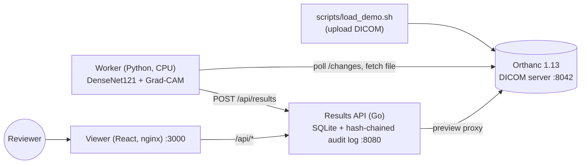
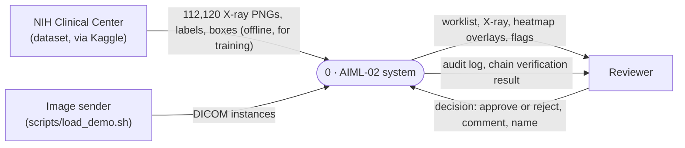
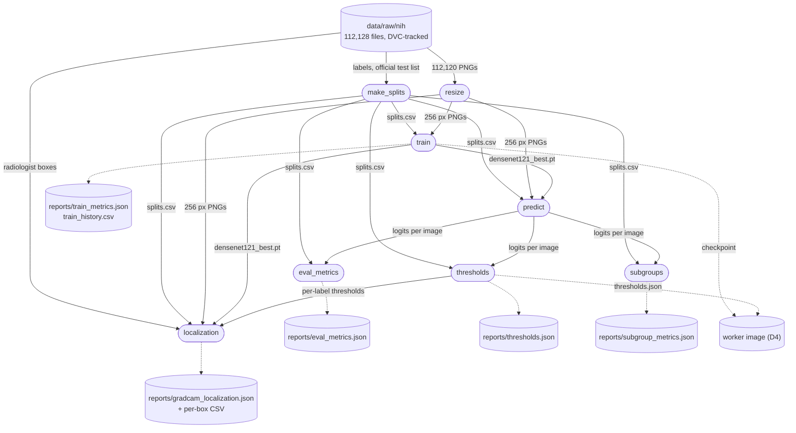
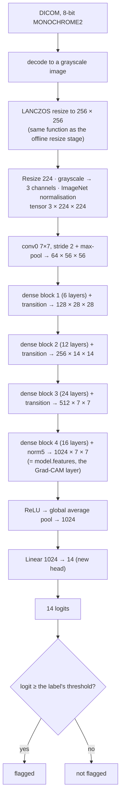
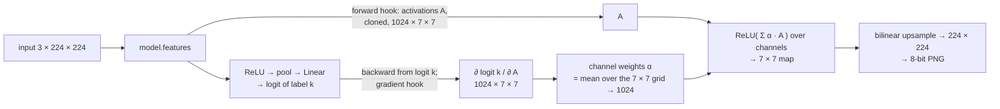
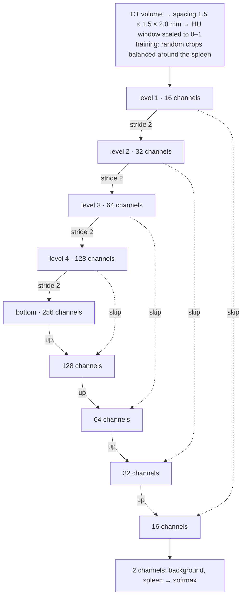
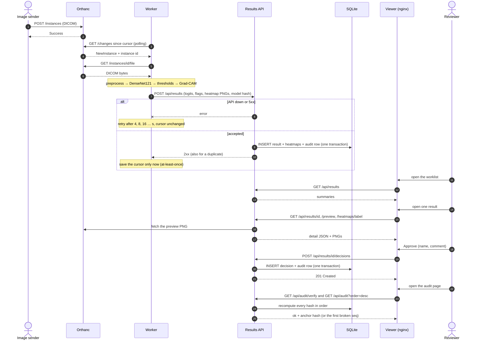
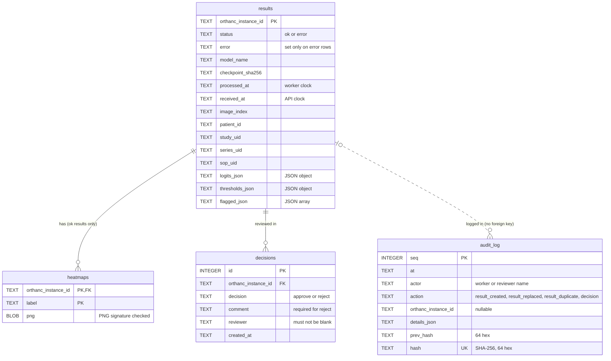
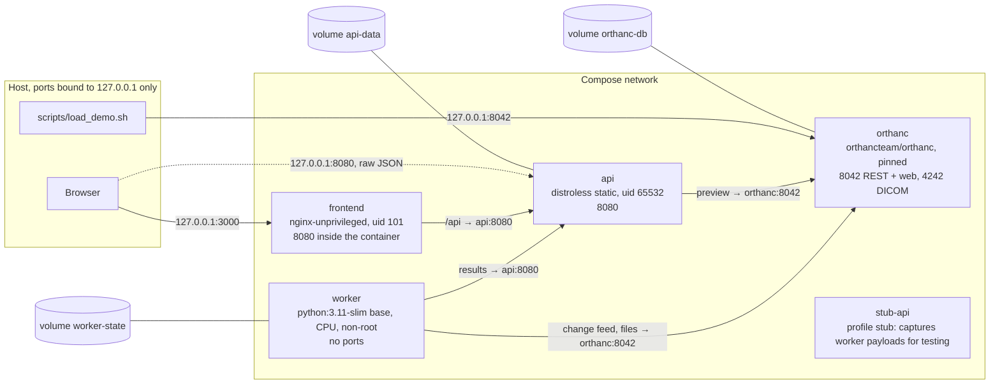

# Architecture

AIML-02 · AI-Assisted Medical Imaging & Diagnosis System. **For education only. Not for clinical use.**

This document describes the system in ten diagrams. Each one names the files it was drawn from, so it can be checked
against the code. All diagrams are Mermaid, which GitHub renders.

1. [System overview](#1-system-overview)
2. [Data flow, level 0 (context)](#2-data-flow-level-0-context)
3. [Data flow, level 1 (serving)](#3-data-flow-level-1-serving)
4. [Data flow, ML pipeline (offline)](#4-data-flow-ml-pipeline-offline)
5. [Model: DenseNet121 classifier](#5-model-densenet121-classifier)
6. [Model: Grad-CAM](#6-model-grad-cam)
7. [Model: 3D U-Net (spleen segmentation)](#7-model-3d-u-net-spleen-segmentation)
8. [One image end to end (sequence)](#8-one-image-end-to-end-sequence)
9. [Results database (ER diagram)](#9-results-database-er-diagram)
10. [Deployment](#10-deployment)

**Data-flow diagram (DFD) notation used in sections 2–4**

| Shape | Meaning |
|---|---|
| Rectangle | External entity (a person or system outside our control) |
| Rounded box, numbered | Process (transforms data) |
| Cylinder, `D`-numbered | Data store |
| Labelled arrow | Data flow. The label is the data that moves, never a control signal |

## 1. System overview

| Component | Technology | Responsibility | Source |
|---|---|---|---|
| Orthanc | Orthanc 1.13 (official image) | Stores DICOM; change feed; preview rendering | `compose.yaml` |
| Worker | Python 3.11, PyTorch (CPU) | Follows the change feed, analyses each new instance, POSTs the result | `src/serve/worker.py`, `src/serve/inference.py` |
| Results API | Go standard library, SQLite (`modernc.org/sqlite`) | The single authority for results, decisions and the audit log | `services/api/` |
| Viewer | React 19 + Vite, served by nginx | Worklist, review page, decisions, audit page | `frontend/` |

The browser only ever talks to nginx (port 3000), which serves the built app and forwards `/api/` to the API, so
everything runs on one origin.

## 2. Data flow, level 0 (context)

## 3. Data flow, level 1 (serving)

```mermaid
flowchart LR
  UP["Image sender"]
  REV["Reviewer"]
  P1(["1 · Store DICOM<br/>(Orthanc)"])
  P2(["2 · Analyse image<br/>(worker)"])
  P3(["3 · Record results and decisions<br/>(results API)"])
  P4(["4 · Present for review<br/>(viewer)"])
  P5(["5 · Verify audit chain<br/>(results API)"])
  D1[("D1 · Orthanc store<br/>volume orthanc-db")]
  D2[("D2 · Results DB, SQLite<br/>results, heatmaps, decisions, audit_log<br/>volume api-data")]
  D3[("D3 · Worker cursor<br/>volume worker-state")]
  D4[("D4 · Checkpoint + thresholds<br/>inside the worker image")]

  UP -- "DICOM file" --> P1
  P1 -- "stored instance" --> D1
  D1 -- "change feed, DICOM bytes" --> P2
  D4 -- "weights, per-label thresholds" --> P2
  D3 -- "last processed change" --> P2
  P2 -- "result: logits, flags, heatmap PNGs, model hash (or error)" --> P3
  P2 -- "new cursor, written only after the API accepted" --> D3
  P3 -- "result rows + audit row, one transaction" --> D2
  D1 -- "X-ray preview PNG" --> P3
  D2 -- "summaries, detail, heatmaps, decision history" --> P3
  P3 -- "JSON and PNG over /api" --> P4
  P4 -- "worklist, overlay, flags" --> REV
  REV -- "approve or reject, comment, name" --> P4
  P4 -- "decision" --> P3
  P3 -- "decision row + audit row" --> D2
  D2 -- "audit_log rows" --> P5
  P5 -- "ok + anchor hash, or first broken seq" --> P4
```

| Store | Written by | Read by | Rules |
|---|---|---|---|
| D1 Orthanc store | P1 | P2, P3 (preview proxy) | Stored instances are never overwritten (`OverwriteInstances: false`) |
| D2 Results DB | P3 only | P3, P5 | `ok` results are write-once; heatmaps, decisions and the audit log are append-only (triggers, section 9) |
| D3 Worker cursor | P2 | P2 | Advanced only after a 2xx answer, so delivery is at-least-once |
| D4 Checkpoint + thresholds | image build (`fetch_assets.sh`, `reports/thresholds.json`) | P2 | Its sha256 is sent with every result and stored with it |

## 4. Data flow, ML pipeline (offline)

The edges between stages are exactly those of `dvc dag` (checked by a script). The labels name the artifacts.

- Splits are **by patient** (`GroupShuffleSplit`, validation fraction 0.2, seed 42). The official NIH test list is the
  test set: 69,625 train / 16,899 validation / 25,596 test images. Source: `src/data/make_splits.py`, `params.yaml`.
- The spleen U-Net (section 7) is trained separately in `notebooks/04_spleen_unet.ipynb` on Kaggle; its outputs are
  tracked with `dvc add models/spleen`.

## 5. Model: DenseNet121 classifier

| | |
|---|---|
| Backbone | torchvision `densenet121` with ImageNet weights; classifier replaced by `Linear(1024, 14)` (`src/models/classifier.py`) |
| Size | about 7.0 M parameters |
| Loss | `BCEWithLogitsLoss` with per-label `pos_weight` = negatives / positives on the training split (`src/train/weights.py`) |
| Optimiser | AdamW, lr 1e-4, weight decay 1e-5; `ReduceLROnPlateau` (factor 0.1, patience 1) (`src/train/train.py`, `params.yaml`) |
| Training | 10 epochs, batch 32, Apple M4 (MPS); best epoch 9 by validation |
| Augmentation | `RandomAffine` only: ±7° rotation, ±5 % shift, 0.95–1.05 scale (`src/data/dataset.py`) |
| Thresholds | one per label, Youden's J on validation (`src/evaluation/thresholds.py` → `reports/thresholds.json`) |

The same resize function and eval transforms are used in training, evaluation and serving (`src/serve/inference.py`),
so the served model sees exactly what it was evaluated on.

## 6. Model: Grad-CAM

- Own implementation with PyTorch hooks (`src/explain/gradcam.py`). The activations are **cloned** inside the hook,
  because DenseNet applies an in-place ReLU to that tensor straight afterwards.
- Heatmaps are made for every **flagged** label, or for the top-scoring label if none is flagged.
- The 7 × 7 grid explains the blobby maps. Against 984 radiologist boxes, the peak lies within 15 px of the box in 51 %
  of cases, against 36 % for shuffled boxes (`src/explain/localization.py`, `reports/gradcam_localization.json`).

## 7. Model: 3D U-Net (spleen segmentation)

| | |
|---|---|
| Network | MONAI `UNet(spatial_dims=3, in_channels=1, out_channels=2, channels=(16, 32, 64, 128, 256), strides=(2, 2, 2, 2), num_res_units=2, norm=BATCH)`, 4.8 M parameters |
| Data | Medical Segmentation Decathlon Task09 Spleen: 41 CTs, 33 train / 8 validation |
| Training | `DiceLoss(to_onehot_y=True, softmax=True)`, Adam lr 1e-4, 600 epochs on a Kaggle T4 |
| Inference | `sliding_window_inference` over the whole volume |
| Result | best Dice 0.942 (epoch 425), plateau median 0.895, last 0.823 |

Source: `notebooks/04_spleen_unet.ipynb`. This model is evaluated but not served.

## 8. One image end to end (sequence)

## 9. Results database (ER diagram)

All tables are `STRICT`, and the rules live in the database itself, not only in Go (`services/api/schema.sql`):

| Rule | Enforced by |
|---|---|
| An `ok` result is write-once; no result is ever deleted | triggers `results_ok_write_once`, `results_no_delete` |
| Heatmaps and decisions only for `ok` results | triggers `heatmaps_require_ok`, `decisions_require_ok` |
| Heatmaps, decisions and audit rows are append-only | `*_no_update` and `*_no_delete` triggers (6) |
| An `ok` row has valid JSON logits, thresholds and flags plus the model hash; an `error` row has an error message | `CHECK` constraints |
| A reject needs a comment; the reviewer name can't be blank | `CHECK` constraints |
| Every audit row links to the previous one | `prev_hash` = the previous row's `hash` (64 zeros for seq 1); `hash` is SHA-256 over the row's contents including `prev_hash` (`services/api/audit.go`) |

`GET /api/audit/verify` recomputes the whole chain. An edited or forged row breaks it at that row. Deleting the newest
rows (truncation) is only detected by comparing against the anchor hash kept outside the system.

## 10. Deployment

- Every base image is pinned by digest (`services/*/Dockerfile`, `frontend/Dockerfile`, `compose.yaml`).
- Start order: the worker and the frontend wait until the API reports healthy.
- nginx resolves `api` at request time (Docker DNS), so a recreated API container is found without restarting nginx.
  Connections time out after 2 s, so a missing API gives a 502 at once.
- The Orthanc login comes from `.env` (see `.env.example`); `docker compose` refuses to start without it.
